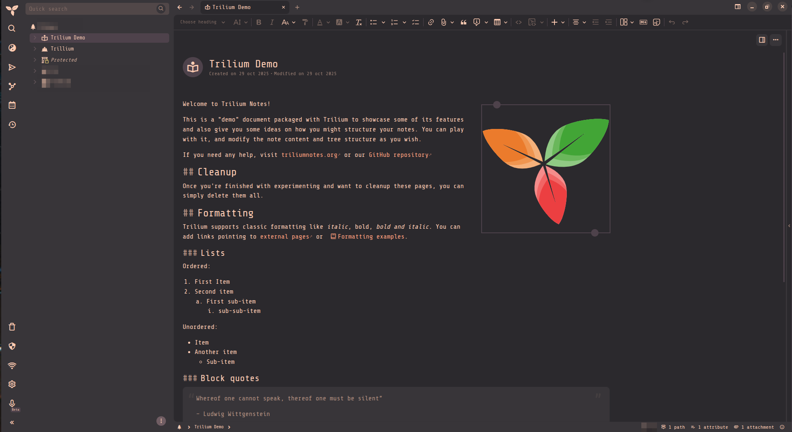

# ferrav2



A dark theme for [TriliumNext](https://github.com/TriliumNext/Trilium) built on the [Ferra](https://github.com/casperstorm/ferra) palette.

Ferra is a warm palette of earthy browns and greens, with blush, coral, and rose as accents. This theme maps those colors onto the built-in Next dark theme: backgrounds, text, selection, links, editors, boards, and the note map. Mixes and translucent states are derived from the official colors. The stylesheet does not introduce hues of its own.

It targets the current TriliumNext interface (`#appThemeBase=next-dark`), not the legacy theme.

## Palette

Official names and values, from the [Ferra README](https://github.com/casperstorm/ferra#palette) and the Alacritty port.

| Name | Hex | Use in this theme |
| --- | --- | --- |
| Night | `#2b292d` | Window and editor background |
| Ash | `#383539` | Panels, cards, inputs, menus |
| Umber | `#4d424b` | Selection and active items |
| Bark | `#6f5d63` | Focus rings, tree expanders |
| Mist | `#d1d1e0` | Kept on the palette. Interface text uses blush |
| Sage | `#b1b695` | Success, tips, done tasks |
| Blush | `#fecdb2` | Text and caret |
| Coral | `#ffa07a` | Links and focus accents |
| Rose | `#f6b6c9` | Keywords and secondary accents |
| Ember | `#e06b75` | Errors and destructive actions |
| Honey | `#f5d76e` | Warnings and search highlights |

A few values come from the official terminal ports and are used the same way:

| Name | Hex | Source |
| --- | --- | --- |
| Black | `#1f1e20` | Alacritty normal black. Code blocks and shadows |
| Red (dim) | `#c05862` | Alacritty normal red |
| Sage (dim) | `#9f9f7c` | Alacritty bright green |

Muted text, placeholders, and hover are precomputed mixes, because the note-map canvas does not understand `color-mix()`:

| Token | Hex | Mix |
| --- | --- | --- |
| Muted | `#ae8f7f` | Blush 62% over night |
| Faint | `#7f6b62` | Blush 40% over night |
| Hover | `#504748` | Ash 88% with blush 12% |

## What it covers

- **Chrome.** Note tree, launch bar, tabs, menus, modals, toasts, quick search, scrollbars, buttons, inputs, and the native title bar. Menus and tooltips are opaque, so the desktop does not show through them.
- **Text notes.** Headings, quotes, tables, highlights, find-in-note, and highlight.js tokens, all in the Ferra palette.
- **Code notes.** CodeMirror 6 gutters, active line, caret, and selection.
- **Boards.** Columns and cards use Ferra surfaces. A note color is mixed into those surfaces so a column stays recognizable and the rest of the palette holds.
- **Elsewhere.** Calendar, admonitions, search-syntax coloring, logs, database space usage, note badges, switches, and the dark Excalidraw canvas.
- **Note map.** Relation lines, anchors, and node fills are set with plain hex, which is what the canvas reader accepts.

Note color (`.with-hue`) is cleared in quick-edit dialogs, calendars, tooltips, and embedded panels, so those surfaces stay on the Ferra backgrounds. On a Kanban board the chosen hue is mixed in at a low ratio.

## Requirements

- TriliumNext, with the Next theme available. The stylesheet overrides Next variables under `#trilium-app` and `:root:root`, because `theme-next-dark.css` is loaded after a custom theme and would otherwise win on equal specificity.
- Optional fonts. The interface asks for **ShureTechMono Nerd Font**. Code asks for **FiraCode Nerd Font**, then **Fira Code**. If neither is installed, the UI falls back to the system monospace font.

## Install

1. In the note tree, create a code note and set its language to CSS. A dedicated parent note for themes keeps them easy to find. See [Creating a custom theme](https://docs.triliumnotes.org/user-guide/theme-development/creating-custom-theme).
2. Paste the contents of [`ferrav2.css`](ferrav2.css) into that note.
3. Add these labels (the owned-attributes button in the status bar):

   ```
   #appTheme=ferrav2
   #appThemeBase=next-dark
   ```

   `appTheme` is the name shown in the theme list. `appThemeBase=next-dark` pins the base to Next dark. Without it, Trilium builds the theme on the legacy light theme. Accepted bases are `next`, `next-light`, and `next-dark`. See [Customize the Next theme](https://docs.triliumnotes.org/user-guide/theme-development/customize-next-theme).

4. Refresh with `Ctrl+Shift+R`, open **Options → Appearance**, and select **ferrav2**.
5. Quit Trilium and open it again. The theme CSS is cached, and the native title bar color is read when the window opens, so a hot refresh does not update it. The title bar is set in hex on `body` for that reason (`#383539` background, `#fecdb2` foreground).

## Credits

Color names and values belong to [Casper Storm’s Ferra](https://github.com/casperstorm/ferra), inspired by [Kanagawa](https://github.com/rebelot/kanagawa.nvim) and [Gruvbox](https://github.com/morhetz/gruvbox). This repository is an independent TriliumNext port and is not affiliated with that project.

Theme hooks follow the [TriliumNext theme guide](https://docs.triliumnotes.org/user-guide/theme-development/).

## License

This is released under the Apache 2.0
